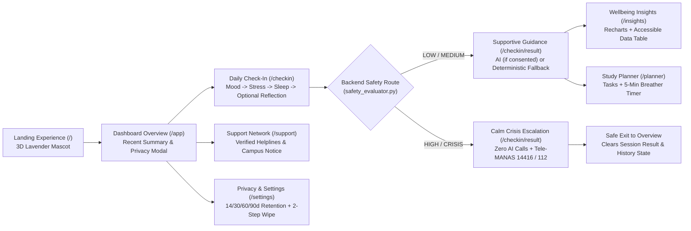
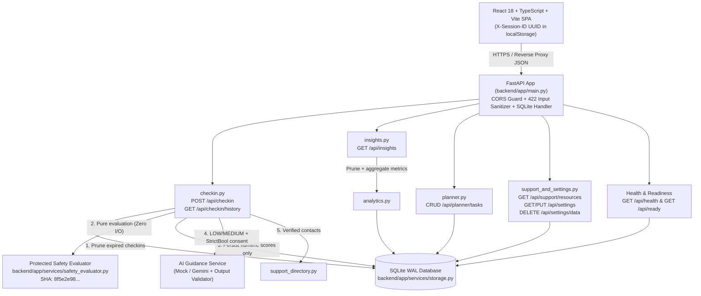
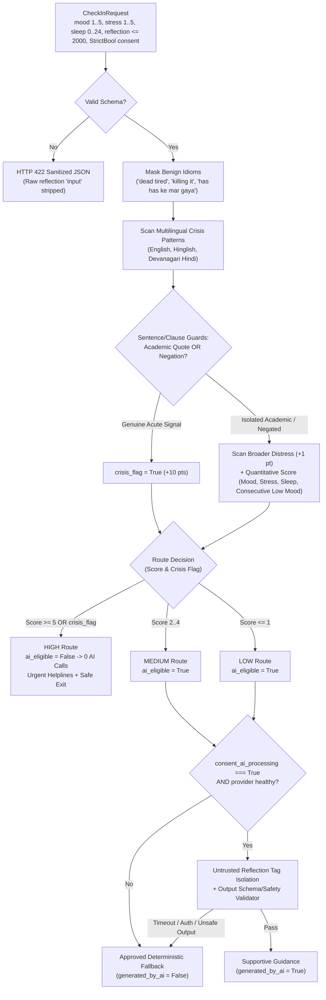
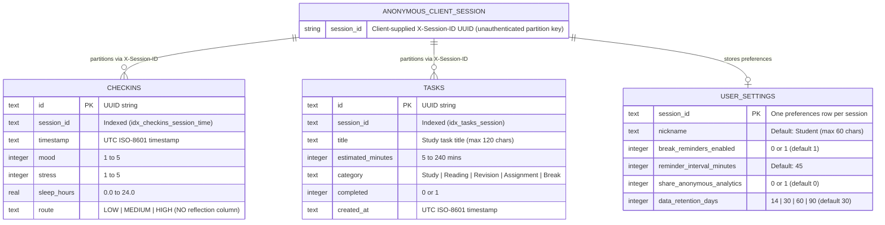
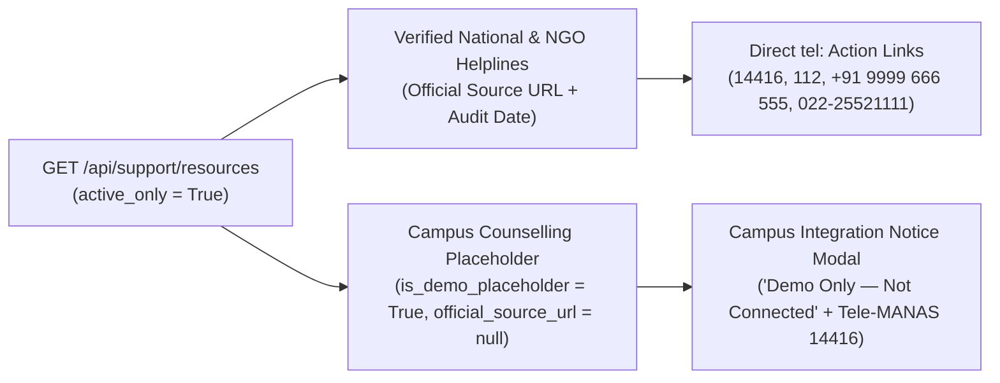
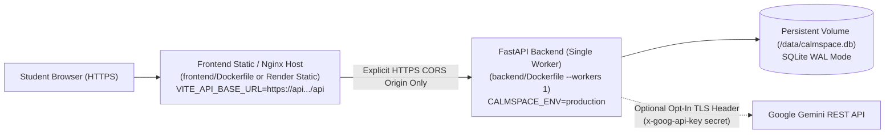

# Calmspace

> **A quieter space to check in with yourself.**

<p align="center">
  
</p>

<p align="center">
  <strong>A privacy-conscious university student wellbeing companion built around Soft Editorial Wellness, deterministic safety routing, and verified human support.</strong>
</p>

<p align="center">
  
  
  
  
</p>

---

## Quick Start

Run the frontend and API locally in two terminals. The default AI provider is `mock`, so the app starts without an external AI key.

**1. Install frontend dependencies and prepare the backend:**

```bash
npm --prefix frontend install
python3 -m venv .venv
source .venv/bin/activate
pip install -r backend/requirements.txt
```

**2. Start the API in the first terminal:**

```bash
npm run backend
```

**3. Start the web app in the second terminal:**

```bash
npm run dev
```

Open [http://localhost:3000](http://localhost:3000). The Vite development server forwards `/api` requests to the backend at `http://127.0.0.1:8000`.

**Useful checks:**

```bash
npm run test:backend
npm --prefix frontend test
npm run build
```

See [Getting Started, Environment & CI Verification](#13--getting-started-environment--ci-verification) for optional configuration and the full local verification workflow.

## Navigation

- [Quick Start](#quick-start)
- [01 — The Idea & Non-Clinical Boundary](#01--the-idea--non-clinical-boundary)
- [02 — Design Philosophy & Visual Tokens](#02--design-philosophy--visual-tokens)
- [03 — Student Experience Flow](#03--student-experience-flow)
- [04 — System Architecture](#04--system-architecture)
- [05 — Deterministic Safety & AI-Bypass Engine](#05--deterministic-safety--ai-bypass-engine)
- [06 — Privacy Lifecycle, Retention & Deletion](#06--privacy-lifecycle-retention--deletion)
- [07 — SQLite Data Model (ER Diagram)](#07--sqlite-data-model-er-diagram)
- [08 — Verified Human Support & Triage](#08--verified-human-support--triage)
- [09 — Deployment Topology & Readiness](#09--deployment-topology--readiness)
- [10 — Implemented Scope vs. Known Limitations](#10--implemented-scope-vs-known-limitations)
- [11 — Team Ownership & Module Boundaries](#11--team-ownership--module-boundaries)
- [12 — Documentation Index & Repository Structure](#12--documentation-index--repository-structure)
- [13 — Getting Started, Environment & CI Verification](#13--getting-started-environment--ci-verification)
- [14 — Accessibility & Contributing](#14--accessibility--contributing)

---

## 01 — The Idea & Non-Clinical Boundary

University life is not just assignments, attendance, deadlines, and examinations — it is also the quiet pressure students carry every day.

Calmspace makes daily emotional check-ins approachable, non-judgmental, and privacy-respecting without feeling like a cold clinical portal or a guilt-driven productivity tracker. It helps students:

- Check in with **mood**, **stress**, **sleep**, and an **optional private reflection**.
- Observe personal wellbeing patterns through accessible visual charts and plain-language summaries.
- Pace study sessions gently with an in-app **Study-Life Balance Planner** and **5-minute breather timer**.
- Receive optional, non-diagnostic supportive language when appropriate.
- Reach **verified national helplines and emergency services** immediately when elevated distress or crisis signals appear.

> [!IMPORTANT]
> **Non-Clinical Guarantee**: Calmspace is **not** a medical device, diagnostic engine, crisis dispatch operator, or replacement for licensed counselling.

$$\text{\textbf{Rules decide safety. AI writes the language. Humans help.}}$$

---

## 02 — Design Philosophy & Visual Tokens

Calmspace follows a **Soft Editorial Wellness** aesthetic — designed to feel like entering a quiet, sunlit study room rather than a clinical triage portal.

| Principle | How It Shapes the Product |
|---|---|
| **Calm over clutter** | Single-column check-in steps, generous whitespace, and zero streak guilt |
| **Human over clinical** | Supportive everyday language (`Doing okay`, `Carrying a lot`) instead of diagnostic labels |
| **Accessible by default** | Keyboard focus trapping, non-color status indicators, data tables alongside charts, reduced motion |
| **Safety before engagement** | Verified `tel:` human support cards immediately supersede charts and AI dialogue on `HIGH` risk |
| **Privacy by architecture** | Reflections have no database column; consent is strict opt-in per request |

### Core Color Tokens (`frontend/src/styles/tokens.css`)

| Token | Hex | Role |
|---|---|---|
| **Background Canvas** | `#F7F6FB` | Serene lavender-tinted paper canvas |
| **Surface** | `#FFFFFF` | Elevated editorial cards and panels |
| **Primary Ink / Action** | `#5554B8` | Primary actions, focus rings (`focus-visible`), active states |
| **Soft Lavender** | `#E9E7FB` | Gentle chips, active tabs, mascot backdrop |
| **Soft Peach** | `#F4DCCB` | Warm accents and demo placeholder notice framing |
| **Soft Sage** | `#DCE9DF` | Steady baseline indicators (`LOW` route, recovery cues) |
| **Main Ink** | `#25233B` | High-contrast body and heading typography |
| **Secondary Ink** | `#625F78` | Muted metadata and captions |

Typography pairs **Cabinet Grotesk** (display headings) with **Satoshi** (body UI), bundled locally in `frontend/public/assets/fonts/` with zero runtime font CDN tracking.

---

## 03 — Student Experience Flow



---

## 04 — System Architecture

Calmspace strictly isolates the React frontend, FastAPI API routers, pure deterministic safety engine, AI guidance adapter, and SQLite WAL persistence layer.



### Technology Stack (Verified Against Manifests)

| Layer | Implemented Technology |
|---|---|
| **Frontend** | React 18 (`^18.3.1`), React Router DOM (`^6.30.6`), TypeScript (`^5.7.2`), Vite (`^6.0.7`) |
| **Styling & Motion** | Tailwind CSS (`^3.4.17`), custom CSS design tokens, Framer Motion (`^11.15.0`), Lucide icons |
| **Charts & 3D** | Recharts (`^2.15.0`), Three.js (`^0.187.0`) custom GLSL lavender mascot |
| **Backend** | Python 3.12+, FastAPI (`>=0.110.0`), Uvicorn (`>=0.28.0`), Pydantic (`>=2.6.0`) |
| **Persistence** | SQLite in WAL mode (`calmspace.db`, `backend/app/services/storage.py`) |
| **AI Providers** | `mock` (offline deterministic default) and `gemini` (`x-goog-api-key` header) with fail-closed fallback |
| **Quality & CI** | Pytest and `pytest-cov`, Ruff lint/format, TypeScript checking, and Vite production builds |

---

## 05 — Deterministic Safety & AI-Bypass Engine

> **Protected Component**: `backend/app/services/safety_evaluator.py`  
> **Immutable Git Blob SHA**: `8f5e2e984c4ab41212a74a16158200b2c7a126b2`

The safety evaluator is a **pure synchronous Python function** with zero network calls, zero database access, and zero LLM dependency. Neither the frontend nor any AI model can alter or downgrade a safety classification.



---

## 06 — Privacy Lifecycle, Retention & Deletion

Calmspace enforces structural privacy minimization rather than relying solely on policy prose:

```mermaid
sequenceDiagram
    autonumber
    actor Student as Student Browser
    participant FE as React Client
    participant API as FastAPI Backend
    participant DB as SQLite WAL (calmspace.db)
    participant AI as Gemini API (Optional)

    Note over Student,FE: Browser generates anonymous UUID in localStorage (X-Session-ID)
    Student->>FE: Submit mood, stress, sleep, reflection + consent (default OFF)
    FE->>API: POST /api/checkin (Header: X-Session-ID, Body: consent_ai_processing)
    API->>DB: cleanup_expired_records(session_id) -> Prune checkins older than 14/30/60/90d
    API->>API: safety_evaluator.evaluate(...) [reflection in RAM only]
    API->>DB: INSERT INTO checkins (id, session_id, timestamp, mood, stress, sleep_hours, route)
    Note over API,DB: NO reflection column exists in checkins; reflection is never logged or persisted

    alt route == HIGH
        API-->>FE: CheckInResponse (guidance = null, verified urgent contacts)
    else route in (LOW, MEDIUM) and consent_ai_processing === true
        API->>AI: Minimal metrics + reflection over TLS (x-goog-api-key header, no session_id)
        AI-->>API: JSON response -> validate_ai_guidance_output()
        API-->>FE: CheckInResponse (AI guidance or safe fallback)
    else unconsented or AI disabled/failed
        API-->>FE: CheckInResponse (deterministic fallback guidance)
    end

    Note over Student,DB: 2-Step Erasure ("Delete all my data" in Settings)
    Student->>FE: Confirm DELETE
    FE->>API: DELETE /api/settings/data (Header: X-Session-ID)
    API->>DB: Atomic Transaction: DELETE FROM checkins, tasks, user_settings WHERE session_id = ?
    API-->>FE: 200 OK (Frontend clears cached result; failure triggers Retry alert)
    Note over FE,DB: Note: Client UUID is not server-revoked; reusing UUID starts a fresh empty session
```

### Key Privacy & Retention Guarantees (Verified by Automated Tests)

1. **Zero Reflection Storage (`checkins` table)**: Checked directly against SQLite `PRAGMA table_info` and row scans in `test_canary_leakage.py`.
2. **Strict Consent Type Checking**: `CheckInRequest.consent_ai_processing` uses Pydantic `StrictBool` — coerced values like `"true"`, `"yes"`, or `1` return `422` without touching AI.
3. **Zero Canary Leakage**: Synthetic canary strings (`SENTINEL_CANARY_REFLECT_*`) are verified absent from Python `logging` (`caplog`), `stdout`/`stderr`, provider timeouts/401s/crashes, sanitized `422` validation responses (via custom `RequestValidationError` handler stripping `"input"`), and `503` database errors.
4. **Configurable Retention Window (`14`, `30`, `60`, or `90` days)**: Default is `30` days. Invalid numbers coerce safely to `30`. Automated pruning runs on request boundaries (`POST /api/checkin`, `GET /api/checkin/history`, `GET /api/insights`, `compute_session_insights`, and `PUT /api/settings`).
5. **Pruning Scope Clarification**: Rolling retention automatically prunes **`checkins` only**. Study `tasks` and `user_settings` persist until individually deleted or erased via `DELETE /api/settings/data`.

---

## 07 — SQLite Data Model (ER Diagram)

All application state lives in three SQLite tables (`backend/app/services/storage.py`, WAL mode enabled). Rows are partitioned logically by the client-supplied `session_id` string (`WHERE session_id = ?`).



---

## 08 — Verified Human Support & Triage

Every support resource rendered in `SupportModal`, `/support`, and `CheckInResultPage` originates from the central canonical directory (`backend/app/services/support_directory.py`), with `is_active: false` entries strictly excluded.



| Resource | Category | Contact | Verification Authority | Last Verified |
|---|---|---|---|---|
| **Tele-MANAS** | Official National Helpline | `14416` / `1800-891-4416` (24/7) | Ministry of Health & Family Welfare (MoHFW), Govt. of India | `2026-11-20` |
| **Emergency Services** | Immediate Dispatch | `112` (24/7) | Emergency Response Support System (ERSS), MHA | `2026-11-20` |
| **Vandrevala Foundation** | Crisis Counselling | `+91 9999 666 555` (24/7) | Vandrevala Foundation Mental Health Registry | `2026-11-20` |
| **iCALL (TISS)** | Psychosocial Helpline | `022-25521111` / `+91 9152 987 821` | School of Human Ecology, TISS | `2026-11-20` |
| **Campus Counselling Unit** | Institutional Template | *Demo Placeholder* (`is_demo_placeholder: true`) | Requires university integration before live use | `Demo` |

---

## 09 — Deployment Topology & Readiness

Deployment containers, production CORS guards, `/api/ready`, and `VITE_API_BASE_URL` support are merged on `main` (PR #37). Live public hosting remains tracked under **Issue #15**.



- **Readiness Endpoint**: `GET /api/ready` runs `SELECT 1` via `storage.check_health()` and returns non-secret AI status (`mock`, `gemini`, `disabled`, or `fallback`), returning `503` without paths or credentials if SQLite fails.
- **No Streamlit**: Deployment manifests (`docker-compose.yml`, `render.yaml`, `Dockerfile`s) exclusively package React + FastAPI.

---

## 10 — Implemented Scope vs. Known Limitations

### Project Status by Issue

| Issue | Scope | Status |
|---|---|---|
| **#1 – #4** | Architecture, deterministic safety engine (`safety_evaluator.py`), multilingual crisis corpus, high-risk escalation | **Closed** |
| **#5 – #9** | AI guidance adapter + fallback, check-in UX, dashboard shell, Insights UI, Study Planner + breather timer | **Closed** |
| **#10 – #14** | SQLite WAL persistence, privacy UI, retention pruning, Support Directory, automated checks, Analytics | **Closed** |
| **#16 – #17** | End-to-end hackathon demo script (`docs/demo_journey.md`) & documentation reconciliation | **Closed** |
| **#15** | Live HTTPS hosting, persistent disk restart verification, and production secrets injection (`@roushan-23`, `@mu368651-eng`) | **Open** *(Repo artifacts merged via PR #37; live host deployment pending)* |

### Explicit Architectural & Repository Limitations (Honest Scope)

1. **SQLite MVP vs. Proposed PostgreSQL/Supabase**: Current persistence uses single-node SQLite in WAL mode (`calmspace.db`), not PostgreSQL/Supabase (`docs/database_architecture_issue_10.md` documents the earlier multi-user PostgreSQL proposal).
2. **`X-Session-ID` Is Relational Isolation, Not Cryptographic Authentication**: Requests without a valid `X-Session-ID` header (`^[A-Za-z0-9._-]+$`, 1–128 chars) are rejected with HTTP `422`, and every query filters by `WHERE session_id = ?` to isolate normal clients, but client-supplied UUIDs lack signed JWTs or hashed secrets. Anyone possessing another browser's exact UUID string can access that session.
3. **Retention Cleanup Prunes `checkins` Only**: Automated request-boundary pruning deletes expired rows in `checkins`; `tasks` and `user_settings` remain until removed individually or via `DELETE /api/settings/data`.
4. **Deletion Does Not Cryptographically Revoke Browser UUIDs**: `DELETE /api/settings/data` atomically purges all DB rows (`checkins`, `tasks`, `user_settings`) for `session_id`, but reusing the same client UUID starts a new empty session.
5. **Campus Support Is a Labeled Demo Placeholder**: The institutional campus entry has `is_demo_placeholder: true` and `official_source_url: null` until configured by a university clinic.

---

## 11 — Team Ownership & Module Boundaries

| Workstream | Owner | Scope & Owned Paths |
|---|---|---|
| **Frontend UX, Insights, Planner & Privacy UI** | **Nikhil Chhetri** ([@nikhi20-900](https://github.com/nikhi20-900)) | `frontend/src/**`, 3D mascot, Check-in, Insights, Planner, Support UI, `PrivacyInventoryModal` |
| **Deterministic Safety & Test Suites** | **Nikhil Chhetri** ([@nikhi20-900](https://github.com/nikhi20-900)) | `backend/app/services/safety_evaluator.py` (protected), multilingual corpus & canary suites |
| **Persistence, Analytics, Retention & Deployment** | **Roushan** ([@roushan-23](https://github.com/roushan-23)) | `storage.py`, `analytics.py`, `api_contracts.md`, live deployment orchestration (Issue #15) |
| **AI Guidance Service & Secrets Hardening** | **Rahul Mandal** ([@mu368651-eng](https://github.com/mu368651-eng)) | `ai_guidance.py`, `ai_validation.py`, `ai_providers/`, `core/config.py`, Gemini secrets (Issue #15) |

---

## 12 — Documentation Index & Repository Structure

### Documentation Index

| Document | Purpose |
|---|---|
| [Architecture & Boundaries](docs/architecture.md) | Contributor boundaries, safety bypass diagram, SQLite session model |
| [API Contracts](docs/api_contracts.md) | REST endpoints, headers, `StrictBool` rules, sanitized `422` schemas |
| [Privacy & Data Inventory](docs/privacy_data_inventory.md) | SQLite table inventory, retention pruning, deletion mechanics & limitations |
| [AI Support Service](docs/ai_support_service.md) | Consent, untrusted-tag prompt isolation, rate limits, fallback rules |
| [Safety Corpus](docs/safety_corpus.md) | Multilingual crisis patterns (English, Hinglish, Devanagari) and negation guards |
| [High-Risk Escalation](docs/high_risk_escalation.md) | Crisis UI, Safe Exit policy, verified helpline provenance |
| [Deployment Guide](docs/deployment.md) | Containers, `/api/ready`, CORS guard, backup/rollback, live host checklist |
| [Demo Journey](docs/demo_journey.md) | 3–5 minute presentation walkthrough and deterministic synthetic personas |
| [DB Architecture Proposal](docs/database_architecture_issue_10.md) | Proposed PostgreSQL/Supabase dual-token architecture (future multi-tenant upgrade) |

### Repository Tree

```text
calmspace/
├── .github/workflows/ci.yml         # CI: Ruff format/lint, Pytest + coverage, tsc & Vite build
├── docker-compose.yml               # Local multi-container stack with persistent /data volume
├── render.yaml                      # Reproducible Render Blueprint (Backend + Static Frontend)
├── package.json                     # Workspace helper scripts
├── backend/
│   ├── Dockerfile                   # Non-root Python 3.12 container (--workers 1)
│   ├── .env.example                 # Placeholder backend environment variables
│   ├── requirements.txt
│   ├── pytest.ini
│   ├── app/
│   │   ├── main.py                  # FastAPI app, production CORS guard, /api/health, /api/ready, 422/DB handlers
│   │   ├── core/config.py           # Env loader & AI configuration validation
│   │   ├── models/schemas.py        # Pydantic contracts (StrictBool consent, 14/30/60/90 retention)
│   │   ├── routers/                 # checkin.py, insights.py, planner.py, support_and_settings.py
│   │   └── services/
│   │       ├── safety_evaluator.py  # PROTECTED (SHA 8f5e2e984c4ab41212a74a16158200b2c7a126b2)
│   │       ├── ai_guidance.py       # Supportive AI orchestration & deterministic fallback
│   │       ├── ai_validation.py     # Prompt safety & output schema validation
│   │       ├── ai_providers/        # Mock & Gemini REST adapters
│   │       ├── analytics.py         # Session-scoped non-diagnostic trend aggregation
│   │       ├── support_directory.py # Verified helpline & demo campus resource registry
│   │       └── storage.py           # SQLite WAL engine, pruning & atomic deletion
│   └── tests/                       # Backend safety, API, persistence, analytics, and companion tests
├── frontend/
│   ├── Dockerfile                   # Multi-stage Node 20 build -> Nginx 1.27 static/proxy server
│   ├── nginx.conf                   # Security headers, /api proxy & SPA routing
│   ├── .env.example                 # Placeholder frontend VITE_API_BASE_URL
│   ├── package.json
│   ├── vite.config.ts
│   └── src/
│       ├── App.tsx                  # React Router routes & PrivacyModalProvider
│       ├── context/                 # PrivacyModalContext
│       ├── services/                # api.ts (VITE_API_BASE_URL + 15s timeout) & fallback resources
│       ├── pages/                   # Landing, Overview, CheckIn, CheckInResult, Insights, Planner, Support, Settings
│       ├── components/              # landing, layout, checkin, planner, privacy, mascot, ui
│       └── styles/                  # Design tokens, typography, globals, animations
└── docs/                            # Architectural, privacy, safety, deployment & demo documentation
```

---

## 13 — Getting Started, Environment & CI Verification

### Prerequisites

- **Node.js** 18+ (CI uses Node 20) & **npm**
- **Python** 3.10+ (CI uses Python 3.12)

### 1. Backend Setup

```bash
python3 -m venv .venv
source .venv/bin/activate
pip install -r backend/requirements.txt

# Optional: copy backend/.env.example to backend/app/.env (never commit secrets)
PYTHONPATH=backend python3 -m uvicorn app.main:app --host 127.0.0.1 --port 8000 --reload
```

- API Base: `http://127.0.0.1:8000`
- OpenAPI Docs: `http://127.0.0.1:8000/docs`
- Liveness / Readiness: `http://127.0.0.1:8000/api/health` and `http://127.0.0.1:8000/api/ready`

### 2. Frontend Setup

```bash
npm --prefix frontend install
npm --prefix frontend run dev -- --host 127.0.0.1 --port 5173
```

- Open `http://localhost:3000` (the port configured in `frontend/vite.config.ts`).

### 3. Environment Variables Reference (`backend/.env.example` & `frontend/.env.example`)

| Variable | Scope | Default | Purpose |
|---|---|---|---|
| `CALMSPACE_ENV` | Backend | `development` | Set to `production` to enforce strict CORS & rate-limit guards |
| `DATABASE_URL` | Backend | `sqlite:///./calmspace.db` | SQLite database file path (use `sqlite:////data/calmspace.db` in containers) |
| `CORS_ORIGINS` | Backend | Dev localhost origins | Comma-separated frontend origins (wildcard `*` rejected in production) |
| `CALMSPACE_AI_PROVIDER` | Backend | `mock` | `mock` (offline deterministic) or `gemini` |
| `CALMSPACE_AI_API_KEY` | Backend | *(empty)* | Gemini secret key (`GEMINI_API_KEY` alias; backend only, never in `VITE_*`) |
| `CALMSPACE_AI_MODEL` | Backend | `gemini-3.8-flash` | Target Gemini model identifier |
| `CALMSPACE_AI_ENABLED` | Backend | `true` | Master toggle (`false` routes all eligible requests to safe fallback) |
| `CALMSPACE_AI_ALLOW_LOCAL_RATE_LIMITER` | Backend | `true` in dev / `false` in prod | Set `true` for single-worker `--workers 1` container MVP |
| `CALMSPACE_VOICE_PROVIDER` | Backend | `browser` | Use browser speech or opt-in `elevenlabs` output |
| `ELEVENLABS_API_KEY` | Backend | *(empty)* | ElevenLabs secret; set only in backend secrets |
| `ELEVENLABS_VOICE_ID` | Backend | *(empty)* | Configured voice ID for backend speech synthesis |
| `VITE_API_BASE_URL` | Frontend | `/api` | Backend API base URL for separate static frontend hosting |

The `/companion` voice and text experience uses these existing AI settings. See [`docs/voice_companion.md`](docs/voice_companion.md) for consent, browser voice behavior, safety routing, fallback, and provider setup.

### 4. Local CI Parity Verification

```bash
# Backend formatting, linting, and test suite
cd backend
ruff format --check .
ruff check .
pytest -v --cov=app.services.safety_evaluator --cov-report=term-missing

# Frontend TypeScript check and production bundle
cd ../frontend
npm run build
```

---

## 14 — Accessibility & Contributing

### Accessibility Commitments

- Semantic landmarks (`<main>`, `<aside>`, `<header>`, `<nav>`) across desktop sidebar and mobile navigation drawer.
- WAI-ARIA keyboard tablist navigation (`PrivacyInventoryModal.tsx`), focus trapping, Escape dismissal, and focus restoration (`Dialog.tsx`, `MobileNavigation.tsx`).
- Non-color badge iconography alongside calm status tokens (`Badge.tsx`) and screen-reader accessible tabular data mirrors on `/insights`.
- `prefers-reduced-motion` support across 3D mascot, landing reveals, and breathing animations (`useReducedMotion.ts`).

### Contributing Workflow

1. Create a scoped branch (`feat/issue-<n>-...`, `fix/issue-<n>-...`, or `docs/...`) from `main`.
2. Never modify `backend/app/services/safety_evaluator.py` without explicit multi-reviewer sign-off.
3. Verify `ruff format --check .`, `ruff check .`, `pytest`, and `npm --prefix frontend run build` pass before opening a pull request.

<p align="center">
  <strong>Built with care for student wellbeing.</strong>
</p>
