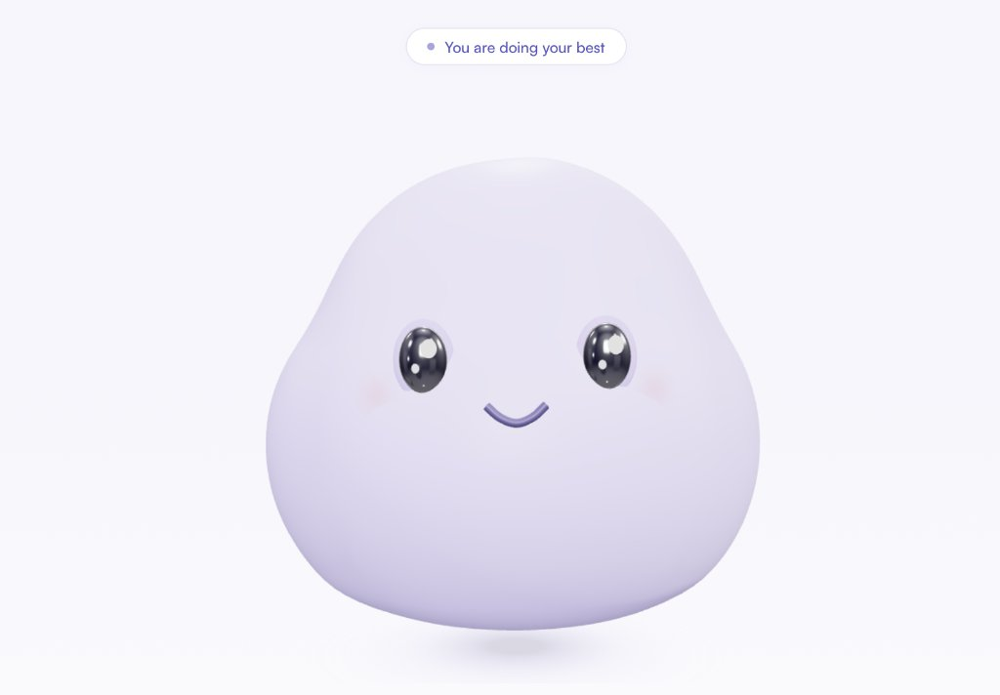
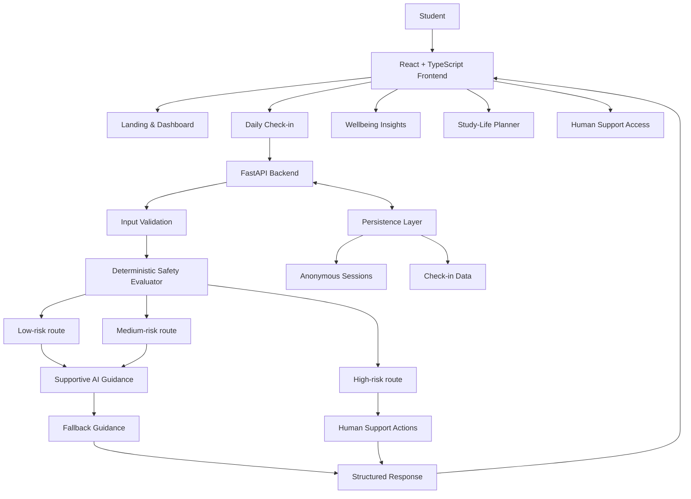
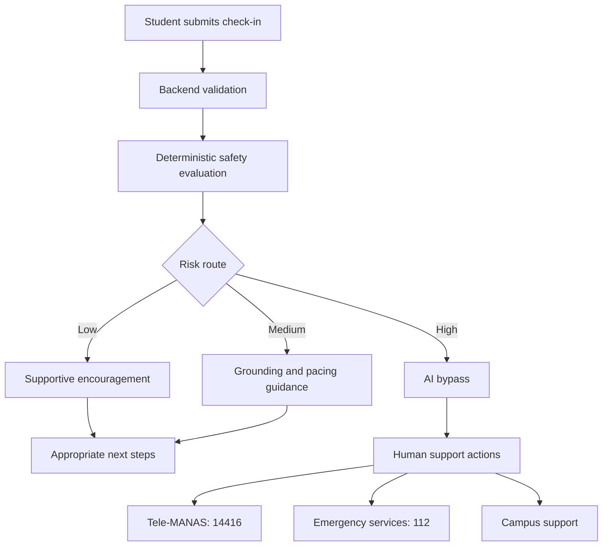
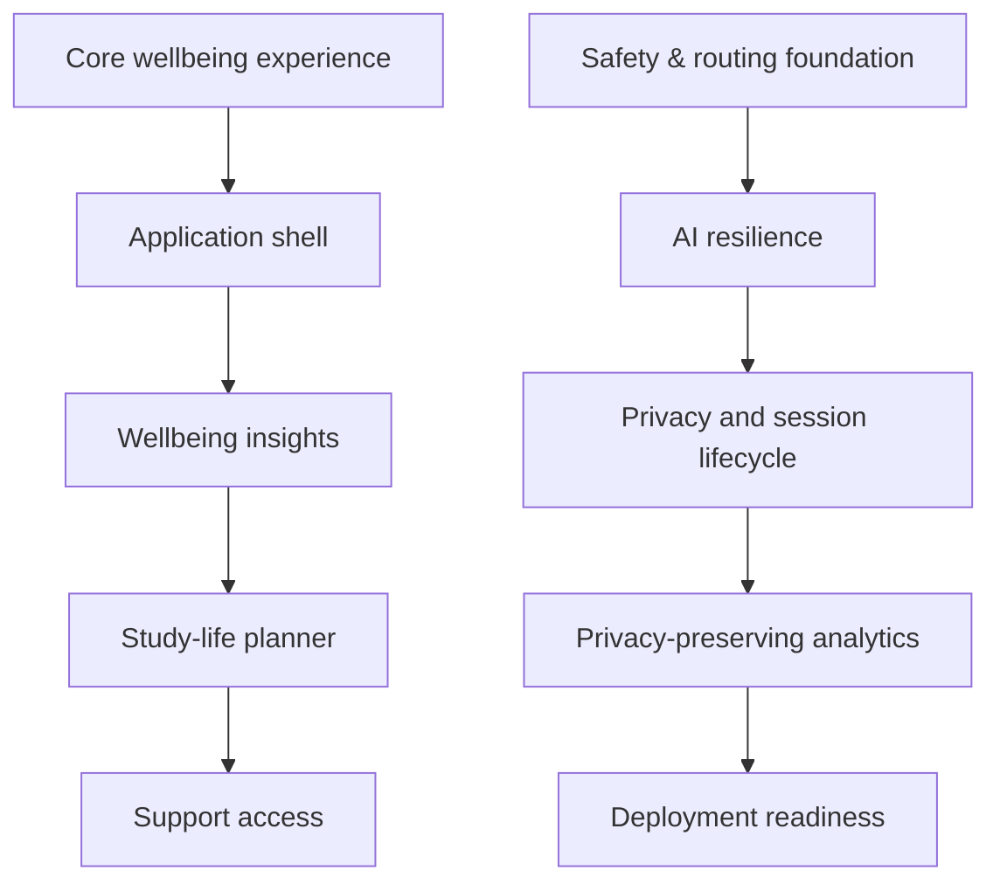

# Calmspace

> **A quieter space to check in with yourself.**

<p align="center">
  
</p>

<p align="center">
  <strong>A student wellbeing companion built around thoughtful design, deterministic safety, and human support.</strong>
</p>

<p align="center">
  
  
  
  
</p>

---

## 01 — The idea

University life is not just about assignments, attendance, deadlines, and examinations. It is also about the pressure students carry quietly.

Calmspace is a privacy-conscious student wellbeing companion designed to make everyday emotional check-ins feel approachable, supportive, and non-clinical.

It helps students:
- Check in with their mood, stress, and sleep.
- Reflect on patterns in their wellbeing.
- Develop healthier study-life routines.
- Access supportive guidance.
- Reach verified human support when they need it.

Calmspace is **not** a diagnostic tool, a replacement for counselling, or a medical service. It is a supportive space that helps students take a moment for themselves.

$$\text{\textbf{Rules decide safety. AI supports language. Humans provide care.}}$$

---

## 02 — Design philosophy

Calmspace follows a **Soft Editorial Wellness** design direction.

Rather than looking like a conventional SaaS dashboard or clinical assessment portal, the experience is designed to feel like entering a quiet, welcoming room.

### Core Principles

| Principle | How it shapes the product |
|---|---|
| **Calm over clutter** | Clear layouts, generous spacing, restrained motion |
| **Human over clinical** | Friendly language instead of diagnostic labels |
| **Accessible by default** | Keyboard navigation, readable charts, reduced motion |
| **Safety before engagement** | Support actions take priority over decorative content |
| **Privacy-conscious** | Optional reflection and deliberate data handling |

### Visual Identity Tokens

| Token | Hex / Value | Purpose |
|---|---|---|
| **Background** | `#F7F6FB` | Serene, warm canvas |
| **Surface** | `#FFFFFF` | Editorial cards and containers |
| **Primary** | `#5554B8` | Focused actions and calm focus rings |
| **Soft Lavender** | `#E9E7FB` | Secondary containers and accent chips |
| **Soft Peach** | `#F4DCCB` | Warm neutral accents |
| **Soft Sage** | `#DCE9DF` | Healthy recovery indicators |
| **Main Text** | `#25233B` | High contrast, warm ink for effortless readability |
| **Secondary Text** | `#625F78` | Subdued metadata and descriptive copy |

Typography uses **Satoshi** and **Cabinet Grotesk** with system fallbacks.

---

## 03 — Product experience

The application is organized around a simple journey:

1. **Arrive** — Explore the Calmspace landing experience.
2. **Check in** — Record mood, stress, sleep, and an optional reflection.
3. **Understand** — Review wellbeing patterns and supportive summaries.
4. **Take a breath** — Use intentional breaks and study-life planning tools.
5. **Connect** — Reach human support when appropriate.

### Main Product Areas

| Area | Purpose | Status |
|---|---|---|
| **Interactive landing page** | Introduces the Calmspace experience with 3D mascot | Implemented |
| **Daily check-in** | Guided mood, stress, and sleep check-in | Implemented |
| **Safety evaluation** | Deterministic wellbeing routing engine | Implemented |
| **Application shell** | Responsive navigation and student dashboard | Implemented |
| **Wellbeing insights** | Accessible Recharts visualisations and summaries | In progress (Issue #8) |
| **Study-life planner** | Intentional pacing and task planning | Planned / assigned (Issue #9) |
| **Support network** | Human support access and directory management | Implemented (directory integration: Issue #12) |
| **Privacy settings** | Preferences, consent controls, and data erasure | Dependent on backend persistence (Issue #10, #11) |

---

## 04 — Architecture

Calmspace separates the user experience, backend safety decisions, supportive language generation, and persistence responsibilities.

### High-Level Architecture



> *Conceptual system view. Persistence and session components are subject to the backend implementation and integration status.*

### Technology Stack

| Layer | Technology |
|---|---|
| **Frontend** | React 19, TypeScript, Vite |
| **Styling** | Tailwind CSS, CSS design tokens |
| **Visualization** | Recharts |
| **Interactive graphics** | Three.js, custom GLSL |
| **Backend** | Python, FastAPI |
| **Validation** | Pydantic |
| **AI integration** | Provider abstraction and fallback architecture |
| **Testing** | Pytest, Playwright, Vitest / Vite build checks |
| **Persistence** | PostgreSQL / Supabase workstream |

---

## 05 — Safety architecture

Safety is a core architectural responsibility, not a decorative feature.

The backend's deterministic safety evaluator makes routing decisions. The frontend displays the returned route but does not independently calculate or override risk.

### Safety Routing Model



### Core Safety Principles

- **Deterministic decisions**: Risk routing is controlled strictly by backend rules.
- **Crisis precedence**: Crisis indicators take precedence over ordinary supportive guidance.
- **High-risk AI bypass**: AI generation is never used on the high-risk route.
- **Fail-safe behavior**: AI provider failures must never undermine safety routing.
- **Human support first**: High-risk experiences prioritize direct, unencumbered support actions.
- **No diagnosis**: Wellbeing indicators are reflective tracking signals, not medical diagnoses.

### Protected Safety Component

```text
backend/app/services/safety_evaluator.py
```

- This file is treated as **immutable**.
- Protected Git blob SHA: `8f5e2e984c4ab41212a74a16158200b2c7a126b2`
- Changes to the evaluator are outside ordinary UI and feature work.
- Any future change requires explicit, separately reviewed authorization.

---

## 06 — Privacy principles

Calmspace aims to minimize unnecessary collection and exposure of sensitive wellbeing information.

### Product Privacy Commitments

1. **Reflection is optional**: Students can check in using ratings alone without text input.
2. **Zero-retention text memory**: Reflection content is never casually included in persistent check-in history.
3. **No intrusive identifiers**: Session identity does not require student roll numbers, logins, or names.
4. **Explicit consent**: Consent is explicit wherever external AI processing is involved.
5. **Backend-enforced deletion**: Data retention and deletion must be enforced by the backend, not merely represented by client controls.

> [!IMPORTANT]
> **Implementation Note on Guarantees**: Privacy guarantees depend on the actual backend and deployment configuration. Anonymous-session persistence, database isolation, retention enforcement, and complete deletion must be verified against their implementation before being described as production guarantees.

---

## 07 — Human support

Calmspace is designed to make human support easy to reach from every screen.

### Verified Support Directory

| Resource | Category | Contact | Verified Source | Last Verified |
|---|---|---|---|---|
| **Tele-MANAS** | National Helpline | `14416` / `1800-891-4416` (24/7) | Ministry of Health & Family Welfare (MoHFW) | `2026-11-20` |
| **Emergency Services** | Urgent Dispatch | `112` (24/7 Instant Dispatch) | Emergency Response Support System (ERSS), MHA | `2026-11-20` |
| **Vandrevala Foundation** | Crisis Counselling | `+91 9999 666 555` (24/7) | Vandrevala Mental Health Registry | `2026-11-20` |
| **iCALL Helpline** | Psychosocial Support | `022-25521111` / `+91 9152 987 821` | School of Human Ecology, TISS | `2026-11-20` |
| **Campus Counselling Unit** | Institutional | *Template Placeholder* | Requires institutional configuration | `Demo` |

> *Institution-specific and other support-directory entries should be published only after their contact details, operating hours, and verification sources have been confirmed. Calmspace does not replace emergency services or professional mental-health care.*

---

## 08 — Development status

Calmspace is being developed incrementally. The following statuses distinguish completed work from active assignments and future scope:

### Implemented
- Interactive Three.js mascot and editorial landing experience.
- Guided daily check-in flow with single-step focus.
- Deterministic safety evaluation and high-risk routing engine.
- 156-test deterministic safety & routing suite (`backend/tests/test_safety_routing_suite.py`).
- AI provider abstraction and fallback architecture.
- Verified support directory and immediate crisis modal.
- Application shell, responsive navigation, and student dashboard (PR #26 merged; Issue #7 closed).

### In Progress
- **Issue #8** — Accessible wellbeing insights, Recharts visualisations, filters, and non-diagnostic summaries.
- **Issue #10** — Backend persistence, PostgreSQL / Supabase schema, and anonymous-session storage (owned by backend workstream).

### Planned / Coordinated
- **Issue #9** — Study-life balance planner and in-app pacing reminders.
- **Issue #11** — Privacy disclosures, consent management, retention policies, and deletion coordination.
- **Issue #12** — Support access and campus institutional support integration.
- **Issue #14** — Privacy-preserving aggregated student analytics.
- **Issue #15** — Docker containerization and production deployment.

---

## 09 — Team ownership

Clear ownership keeps the project maintainable and prevents accidental changes to protected work.

| Workstream | Owner | Responsibilities |
|---|---|---|
| **UI/UX and application experience** | **Nikhil Chhetri** — [@nikhi20-900](https://github.com/nikhi20-900) | Design system, React application shell, responsive navigation, check-in experience, insights UI |
| **Safety & Risk Engine** | **Nikhil Chhetri** — [@nikhi20-900](https://github.com/nikhi20-900) | Deterministic safety logic ownership, crisis precedence, regression coverage, AI-bypass contracts |
| **Database and anonymous sessions** | **Roushan** — [@roushan-23](https://github.com/roushan-23) | PostgreSQL/Supabase, session persistence, token handling, database isolation |
| **AI integration** | **AI workstream** | Provider integration, prompt contracts, fallback behavior, resilience |
| **Support directory** | **Institutional / support workstream** | Contact verification, campus resources, safe support access |

### Ownership Boundaries

- UI contributors should integrate against agreed API contracts rather than independently changing database persistence.
- Database and session changes should be coordinated with the backend owner.
- Safety evaluator changes require explicit authorization and dedicated review.
- Frontend copy must not promise privacy or anonymity beyond what the backend actually enforces.
- Cross-workstream changes should be discussed before implementation.

---

## 10 — Repository structure

```text
calmspace/
├── backend/
│   ├── app/
│   │   ├── models/              # Pydantic schemas
│   │   ├── routers/             # API endpoints (checkin, insights, planner, support)
│   │   ├── services/
│   │   │   ├── safety_evaluator.py  # PROTECTED (Immutable risk engine)
│   │   │   ├── ai_guidance.py       # Supportive AI guidance & fallbacks
│   │   │   ├── support_directory.py # Verified support directory
│   │   │   └── storage.py           # Ephemeral storage foundation
│   │   └── main.py              # FastAPI application entry point
│   ├── tests/                   # Automated safety, corpus, and routing suites
│   ├── requirements.txt
│   └── pytest.ini
│
├── frontend/
│   ├── src/
│   │   ├── components/
│   │   │   ├── landing/         # Editorial landing page sections
│   │   │   ├── layout/          # AppLayout, Sidebar, MobileNavigation, SupportModal
│   │   │   ├── checkin/         # Mood, stress, sleep, and reflection steps
│   │   │   ├── mascot/          # 3D interactive lavender character
│   │   │   └── ui/              # Button, Card, Badge, Slider, Dialog primitives
│   │   ├── pages/               # LandingPage, OverviewPage, CheckInPage, InsightsPage, etc.
│   │   ├── services/            # API client and canonical support directory
│   │   ├── styles/              # Design tokens, typography, and animations
│   │   ├── types/               # TypeScript interfaces
│   │   ├── App.tsx              # React router routing
│   │   └── main.tsx
│   ├── package.json
│   └── vite.config.ts
│
├── docs/                        # Architectural specifications, privacy inventories, and safety corpus
└── package.json
```

---

## 11 — Getting started

### Prerequisites

- Node.js 18 or later
- Python 3.10 or later
- npm

### 1. Backend Setup

From the repository root:

```bash
# Create and activate a virtual environment if desired
python3 -m venv .venv
source .venv/bin/activate

# Install backend dependencies
pip install -r backend/requirements.txt

# Start FastAPI server
PYTHONPATH=backend python3 -m uvicorn app.main:app --host 127.0.0.1 --port 8000 --reload
```

- API Base: `http://127.0.0.1:8000`
- Interactive API Documentation: `http://127.0.0.1:8000/docs`

### 2. Frontend Setup

In a separate terminal:

```bash
npm --prefix frontend install
npm --prefix frontend run dev
```

Open the local development URL printed by Vite (typically `http://localhost:5173` or `http://localhost:3000`).

### 3. Production Build

```bash
npm --prefix frontend run build
```

### 4. Running Backend Tests

```bash
cd backend && pytest tests
```

---

## 12 — Accessibility

Accessibility is part of the interaction design, not a final checklist.

Calmspace provides:
- **Semantic page structure**: Meaningful landmarks (`<main>`, `<aside>`, `<header>`, `<nav>`).
- **Keyboard navigation**: Accessible focus trapping and restoration on modal drawers and dialogs.
- **Visible focus indicators**: Custom 2px calm focus rings (`focus-visible:ring-[#5554B8]`).
- **Touch-friendly controls**: Minimum 44px touch targets on buttons, sliders, and navigation items.
- **Screen-reader data tables**: Tabular data mirrors accompanying all visual charts.
- **Non-color-only signalling**: Status badges feature distinct iconography alongside color tokens.
- **Reduced motion**: Strict support for `prefers-reduced-motion` across animations and transitions.
- **Non-diagnostic language**: Supportive, non-clinical explanations that never pathologize student experiences.

---

## 13 — Contributing

Before opening a pull request:
1. Check the relevant GitHub issue and assigned owner.
2. Confirm the API contract before integrating across frontend and backend.
3. Keep changes strictly within the agreed workstream.
4. Add or update tests where appropriate.
5. Run the relevant lint, test, and build checks locally.
6. Document meaningful changes and limitations.
7. Request review from the relevant owner.

### Suggested Branch Naming

```text
feat/issue-<number>-short-description
fix/issue-<number>-short-description
docs/short-description
```

### Pull Request Expectations

A useful pull request explains:
- What changed and why.
- Which issue it addresses.
- Which files and workstreams it affects.
- How it was tested.
- Whether it changes API contracts, privacy behavior, or safety behavior.
- Any remaining limitations.

---

## 14 — Roadmap



> *The roadmap is an evolving plan, not a promise that every feature is already available.*

---

## 15 — A final note

Calmspace is built around a simple belief:

> Students should not need to wait until they are overwhelmed to take care of their wellbeing.

A small check-in, a moment to breathe, a better understanding of personal patterns, or a direct connection to a real person can matter. Calmspace is a place to pause, reflect, and find the next small step.

<p align="center">
  <strong>Built with care for student wellbeing.</strong>
</p>
