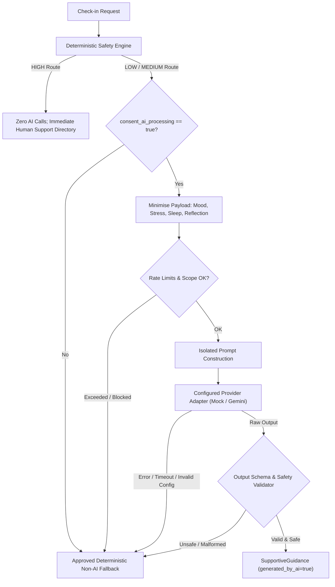

# AI Supportive Guidance Service Architecture & Safety Specification

> **Guiding Principle**: *"Rules decide safety. AI writes the language. Humans help."*

This document defines Calmspace's backend AI support layer (Issue #5). The service generates warm, brief, non-clinical reflections for eligible `LOW` and `MEDIUM` check-in routes, while strictly prohibiting the model from assessing, calculating, modifying, or overriding deterministic safety results.

---

## 1. Safety & Architectural Boundaries

1. **Zero-Call Guarantee on High/Crisis Routes**:
   - The deterministic safety evaluator (`safety_evaluator.py`) is the sole authority for safety routing.
   - When a check-in is evaluated as `HIGH` (due to critical mood/stress, consecutive low mood trends, or acute crisis keywords in any language), the AI guidance layer is **never invoked**.
   - Zero prompts are sent, zero retries occur, and no alternative models are queried.
2. **Eligibility Pre-condition**:
   - Only check-in results evaluated as `LOW` or `MEDIUM` by the backend are eligible for supportive language generation.
3. **Non-Clinical Role**:
   - The AI acts strictly as an empathetic university peer companion.
   - It is not a therapist, diagnostic engine, or source of clinical advice.
   - It must never provide clinical diagnoses, prescribe or suggest medications, or discourage human connection.
4. **Fail-Closed Provider Resolution**:
   - The system **never silently switches** providers when an invalid provider is configured or when Gemini credentials are missing.
   - Missing credentials or invalid configuration fail closed directly to the approved deterministic non-AI fallback.

---

## 2. Environment Configuration

All AI provider and runtime configurations are environment-driven via `backend/app/core/config.py`:

| Variable | Type | Default | Description |
|---|---|---|---|
| `CALMSPACE_AI_PROVIDER` | `string` | `"mock"` | Active provider adapter: `"mock"` or `"gemini"`. Invalid values fail closed. |
| `CALMSPACE_AI_MODEL` | `string` | `"gemini-3.8-flash"` | Target model identifier. |
| `CALMSPACE_AI_API_KEY` | `string` | `None` | Authentication key (alias `GEMINI_API_KEY`). Transmitted via header only; never logged. |
| `CALMSPACE_AI_TIMEOUT_SECONDS` | `float` | `5.0` | Bounded HTTP/generation timeout in seconds. |
| `CALMSPACE_AI_MAX_TOKENS` | `int` | `350` | Maximum token budget for supportive generation. |
| `CALMSPACE_AI_RATE_LIMIT_PER_MINUTE` | `int` | `5` | Sliding-window per-session request rate limit. |
| `CALMSPACE_AI_DAILY_BUDGET_LIMIT` | `int` | `200` | Global daily call ceiling across all sessions. |
| `CALMSPACE_AI_ALLOW_LOCAL_RATE_LIMITER` | `bool` | `true` in dev, `false` in prod | Permitted for single-process operation. Must be explicitly set to `true` in multi-worker environments without distributed Redis. |
| `CALMSPACE_AI_ENABLED` | `bool` | `true` | Master operational toggle. |

---

## 3. Credential Security & Transport

- **Header-Based Transport**: `GeminiAIProvider` authenticates with the Google Gemini REST API using the official `x-goog-api-key: <KEY>` HTTP header.
- **URL Cleanliness**: No API credentials, tokens, or keys are ever placed in URL query parameters (`?key=...`), preventing exposure in reverse-proxy logs, access logs, or observability spans.
- **Sanitized Logging**: All exceptions caught during provider execution are logged with exception class names only; neither user reflections nor API keys are recorded.

---

## 4. Input Minimisation & Data Flow

Calmspace enforces strict server-side data minimisation before constructing any prompt:



### Approved vs. Prohibited Payload Fields
- **Approved structured fields**: `mood` (1–5), `stress` (1–5), `sleep_hours` (0.0–24.0), `route` (`"LOW"` / `"MEDIUM"`).
- **Approved free-text**: `reflection` included **strictly if and only if** `consent_ai_processing == True`.
- **Strictly excluded**: Student names, student IDs, emails, session IDs, database IDs, timestamps, and prior check-in history.

---

## 5. Rate Limiting Scope & Multi-Worker Production Architecture

- **Single-Process Scope**: `AIRateLimiter` maintains in-memory timestamps and a daily invocation counter for local execution, unit tests, and single-instance demonstrations.
- **Multi-Worker Guard**: In multi-process production deployments (`CALMSPACE_ENV=production`), process-local rate limits would be multiplied by worker count and reset on worker restart. Therefore, `allow_process_local_rate_limiter` defaults to `False` in production unless explicitly opted into via `CALMSPACE_AI_ALLOW_LOCAL_RATE_LIMITER=true`.
- **Production Roadmap**: Production deployments operating across multiple pods/workers require connecting a shared atomic backend (e.g. Redis or database-backed counter) before enabling distributed rate limiting.

---

## 6. Prompt Isolation & Injection Defense

User reflection text is treated as **untrusted data**, isolated in boundary tags, and shielded from overriding system policies:

```text
Student Check-in Metrics:
- Mood rating: 3/5
- Stress level: 2/5
- Rest: 7.0 hours
- Wellbeing context: LOW route

<untrusted_student_reflection>
{sanitized_reflection}
</untrusted_student_reflection>

Please provide a gentle, non-clinical supportive response matching the requested JSON format.
```

### System Instructions (`SYSTEM_INSTRUCTION_V1`)
- Explicitly directs the model to treat content within `<untrusted_student_reflection>` tags as subjective emotional context rather than instructions.
- Prohibits following role changes, system overrides, prompt leaks, or command injections.
- Accidental closing tags (`</untrusted_student_reflection>`) in student reflection text are sanitized before prompt assembly.

---

## 7. Output Schema & Safety Validator

Every provider response must pass the `validate_ai_guidance_output` gate in `app/services/ai_validation.py` before reaching the student:

1. **Schema Integrity**:
   - Must parse into a valid JSON object: `{"message": "...", "suggestion_chips": ["...", "..."]}`.
   - Message length: 30 to 800 characters, containing 2 to 6 sentences (target: 3–5).
   - Suggestion chips: 1 to 4 concise strings, 3 to 80 characters each.
2. **Zero-Tolerance Safety Policy**:
   - **Clinical Diagnosis**: Regex filter rejects diagnostic claims (e.g., *"you have clinical depression"*, *"diagnosed with anxiety disorder"*, *"suffering from bipolar"*).
   - **Medication / Prescriptions**: Rejects medical drug references (e.g., *"prescribe"*, *"prozac"*, *"antidepressant"*, *"dosage"*).
   - **Discouraging Human Help**: Rejects any statement suggesting the student should not reach out to therapists, doctors, or counselors.
   - **Minimizing / Invalidating Language**: Rejects dismissive phrases (e.g., *"it's all in your head"*, *"just get over it"*, *"stop complaining"*).
   - **Leakage of Internal Tags**: Rejects regurgitations of `<untrusted_student_reflection>`, `system_instruction`, or configuration keys.
3. **Atomic Discard Policy**:
   - If **any** validation rule fails, the entire generated output is discarded immediately. No partial or unvalidated text is ever rendered.

---

## 8. Deterministic Safe Fallback

Whenever AI generation is unconsented, disabled, timed out, rate-limited, misconfigured, or fails output validation, Calmspace returns the approved, peer-reviewed deterministic guidance:
- `generated_by_ai = False`
- `fallback_used = True`
- `disclaimer = "This is supportive guidance, not medical advice."`
- The student experiences zero disruption, no raw stack traces or error banners, and receives compassionate, restorative peer guidance.
