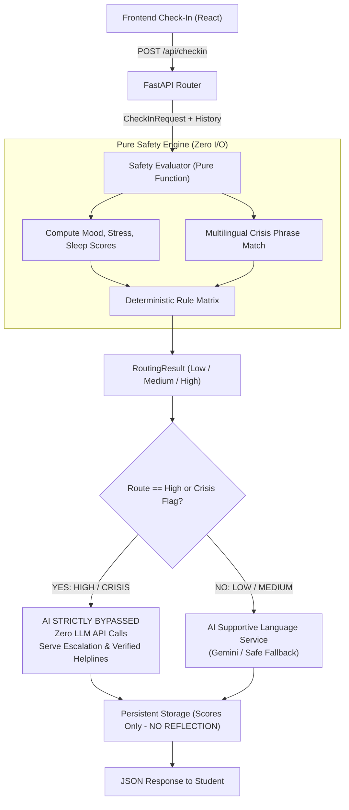

# Calmspace System Architecture & Contributor Boundaries

> **Core Motto**: *Rules decide safety. AI writes the language. Humans help.*

Calmspace is an emotionally comforting, privacy-first university student wellbeing companion. This document defines the system boundaries, module ownership across the four team contributors, branching workflow, and safety-critical isolation rules.

---

## 1. Workstream Ownership & Module Boundaries

| Workstream | Primary Owner | Module Boundaries & Directory Ownership |
|---|---|---|
| **Member 1: Frontend Foundation & UX** | Member 1 | `frontend/src/pages/`, `frontend/src/components/`, `frontend/src/styles/`<br>• Interactive 3D mascot (`BlobController.tsx`, `BlobScene.tsx`)<br>• Single-column check-in flow & inputs<br>• Recharts wellbeing visualisations<br>• Student dashboard & navigation shell |
| **Member 2: Safety & Routing Engine** | Member 2 | `backend/app/services/safety_evaluator.py`, `backend/tests/data/safety_corpus.json`, `docs/safety_corpus.md`<br>• Pure deterministic rule engine (no network, no DB, no LLM)<br>• Multilingual crisis phrase detection (English, Devanagari, Hinglish)<br>• Automated safety test suites |
| **Member 3: AI Supportive Guidance** | Member 3 | `backend/app/services/ai_guidance.py`<br>• Empathetic supportive language generation for Low/Medium routes<br>• Strict prompt guardrails preventing clinical diagnoses<br>• Guaranteed non-AI deterministic fallback |
| **Member 4: Persistence, Analytics & Integration** | **@roushan-23** | `backend/app/services/storage.py`, `backend/app/routers/insights.py`, `docs/api_contracts.md`, configuration & deployment<br>• Anonymous session persistence & session isolation<br>• Zero-storage policy for student reflections<br>• Privacy-preserving analytics aggregation<br>• Shared contracts & local/cloud environment orchestration |

---

## 2. The Deterministic Safety Boundary & AI Bypass Rule

The system architecture enforces a strict physical boundary between **Safety Evaluation** and **AI Generation**:



### Safety Engine Contract
The safety evaluator exposes a pure, synchronous function:
```python
evaluate(checkin: CheckInRequest, history: list[CheckInRecord]) -> RoutingResult
```
* **No Side Effects**: It must **never** perform database queries, network requests, file I/O, or LLM API calls.
* **Non-Overridable**: The frontend and AI service cannot modify or override the calculated `route` or `crisis_detected` flag.
* **High-Risk AI Bypass**: Whenever `route == "high"` or `crisis_detected == True`, all AI provider calls are completely disabled. The student receives immediate access to verified emergency resources (`Tele-MANAS 14416`, Campus Psychologists, `112`).

---

## 3. Privacy & Session Model

1. **No User Accounts**: Calmspace does not request or store student names, emails, roll numbers, or passwords.
2. **Anonymous Session Token**:
   - The frontend generates an anonymous UUID session token (stored locally in `localStorage`).
   - Every API request sends the header: `X-Session-ID: <anonymous_session_id>`.
3. **Zero Reflection Retention**:
   - Student free-text reflections are processed in-memory during the check-in request to check for crisis keywords and generate supportive guidance.
   - **The free-text reflection is never written to the database.** Only anonymized numeric scores (`mood`, `stress`, `sleep_hours`), the assigned `route`, and the timestamp are persisted.
4. **Full 2-Step Data Deletion**:
   - Students can permanently purge all data associated with their session token via `POST /api/settings/delete-all-data`.

---

## 4. Contributor Workflow & Git Conventions

- **Default Branch**: `main` (always protected, must pass CI tests).
- **Branch Naming**:
  - `feat/issue-<num>-<short-description>` (e.g. `feat/issue-10-persistent-storage`)
  - `fix/issue-<num>-<short-description>`
- **Commit Messages**: Follow Conventional Commits:
  - `feat(storage): implement SQLite persistence for anonymous check-ins`
  - `fix(safety): handle edge case in sleep hour boundary`
  - `test(backend): add cross-session negative tests`
  - `docs(contracts): update API specification for insights router`
- **Review Requirement**: Any PR modifying `app/services/safety_evaluator.py` or `app/models/schemas.py` requires cross-review by at least two contributors.
