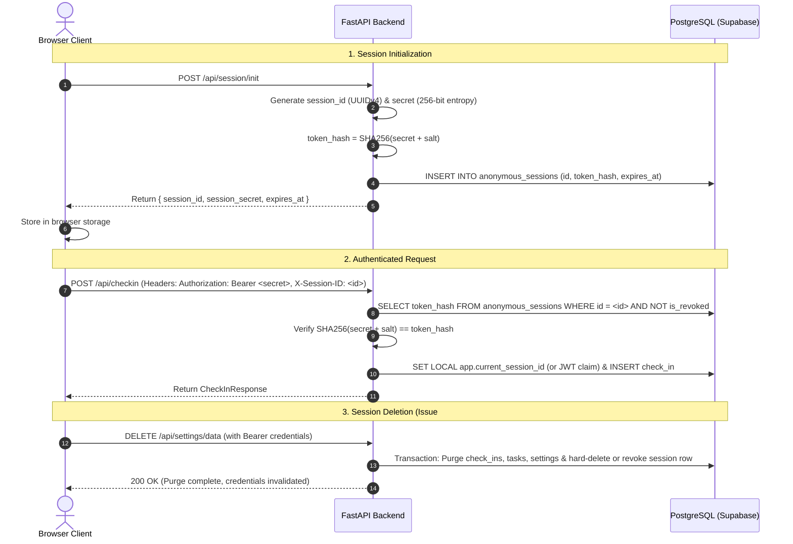

# Architecture & Database Review: Issue #10 & Issue #11

> **Status**: Proposed for Team Alignment & Review (DB Implementation Paused Pending Roushan's Approval)  
> **Primary Owner (Issue #10)**: @roushan-23 (Member 4 — Database & Persistence)  
> **Primary Owner (Issue #11)**: @nikhi20-900 (Privacy Disclosures, Consent, Retention & Deletion)  
> **Safety Boundary**: `backend/app/services/safety_evaluator.py` MUST remain strictly immutable throughout this work.

---

## 1. Executive Summary & Core Requirements

Calmspace enables university students to check in and receive gentle, non-clinical wellbeing support completely anonymously, without registration, real names, or email addresses.

To transition from in-memory storage to persistent hosting while preserving student privacy, we propose:
1. **Database Provider**: PostgreSQL via Supabase (hosted) with Row-Level Security (RLS) or server-side transaction scoping, plus a local engine-agnostic repository layer for offline CI and unit tests.
2. **Cryptographic Anonymous Sessions**: High-entropy dual-token credentials (`session_id` + hashed `session_secret`). Plain `session_id` values must never serve as standalone authorization.
3. **Trusted Cross-Session Isolation**: Server-side credential verification paired with cryptographically trusted RLS policies (never trusting client-influenced settings).
4. **Zero Persistence for Reflection Text**: Free-text reflections are never saved in database tables.
5. **Reconciled Issue #11 Retention & Deletion Contract**: Pending team approval on 30-day default retention, 60-day vs. 90-day inactivity expiry, HIGH-route handling, and atomic deletion/revocation behavior.

---

## 2. Anonymous Identity & Session Lifecycle

### Current vs. Proposed Architecture

| Property | Current MVP | Proposed Architecture (Issue #10) |
|---|---|---|
| **Identifier** | Client UUID in `localStorage` | Server-issued UUIDv4 `session_id` |
| **Credential** | Plain `X-Session-ID` header | High-entropy 256-bit secret token (`Bearer <session_secret>`) |
| **Server Storage** | In-memory Python dictionary | Salted SHA-256 hash in PostgreSQL `anonymous_sessions` |
| **Tamper Resistance** | None (guessing an ID accesses data) | Cryptographically secure: guessing a `session_id` grants zero access |
| **Transport** | Header | `Authorization: Bearer <secret>` + `X-Session-ID: <uuid>` (never in URL params) |



---

## 3. Draft Relational Schema (Pending Roushan's Approval)

```sql
-- 1. Anonymous Sessions Table
-- PENDING APPROVAL: Agree on 60-day vs 90-day inactivity expiry
CREATE TABLE IF NOT EXISTS anonymous_sessions (
    id UUID PRIMARY KEY DEFAULT gen_random_uuid(),
    token_hash VARCHAR(64) NOT NULL,
    created_at TIMESTAMPTZ NOT NULL DEFAULT timezone('utc', now()),
    last_active_at TIMESTAMPTZ NOT NULL DEFAULT timezone('utc', now()),
    expires_at TIMESTAMPTZ NOT NULL DEFAULT timezone('utc', now() + INTERVAL '60 days'), -- Pending: 60d vs 90d
    is_revoked BOOLEAN NOT NULL DEFAULT FALSE
);

CREATE INDEX IF NOT EXISTS idx_anonymous_sessions_lookup 
ON anonymous_sessions (id, is_revoked, expires_at);

-- 2. Check-Ins Table (Zero Reflection Text Stored!)
CREATE TABLE IF NOT EXISTS check_ins (
    id UUID PRIMARY KEY DEFAULT gen_random_uuid(),
    session_id UUID NOT NULL REFERENCES anonymous_sessions(id) ON DELETE CASCADE,
    timestamp TIMESTAMPTZ NOT NULL DEFAULT timezone('utc', now()),
    mood SMALLINT NOT NULL CHECK (mood BETWEEN 1 AND 5),
    stress SMALLINT NOT NULL CHECK (stress BETWEEN 1 AND 5),
    sleep_hours NUMERIC(4, 1) NOT NULL CHECK (sleep_hours >= 0.0 AND sleep_hours <= 24.0),
    route VARCHAR(10) NOT NULL CHECK (route IN ('LOW', 'MEDIUM', 'HIGH'))
);

CREATE INDEX IF NOT EXISTS idx_check_ins_session_time 
ON check_ins (session_id, timestamp DESC);

-- 3. Study Planner Tasks Table
CREATE TABLE IF NOT EXISTS study_tasks (
    id UUID PRIMARY KEY DEFAULT gen_random_uuid(),
    session_id UUID NOT NULL REFERENCES anonymous_sessions(id) ON DELETE CASCADE,
    title VARCHAR(120) NOT NULL,
    estimated_minutes SMALLINT NOT NULL CHECK (estimated_minutes BETWEEN 5 AND 240),
    category VARCHAR(50) NOT NULL DEFAULT 'Study',
    completed BOOLEAN NOT NULL DEFAULT FALSE,
    created_at TIMESTAMPTZ NOT NULL DEFAULT timezone('utc', now())
);

CREATE INDEX IF NOT EXISTS idx_study_tasks_session 
ON study_tasks (session_id, created_at DESC);

-- 4. User Settings Table
-- PENDING APPROVAL: Default 30d; permitted UI options 14, 30, 60, or 90 days
CREATE TABLE IF NOT EXISTS user_settings (
    session_id UUID PRIMARY KEY REFERENCES anonymous_sessions(id) ON DELETE CASCADE,
    nickname VARCHAR(60) NOT NULL DEFAULT 'Student',
    break_reminders_enabled BOOLEAN NOT NULL DEFAULT TRUE,
    reminder_interval_minutes SMALLINT NOT NULL DEFAULT 45,
    share_anonymous_analytics BOOLEAN NOT NULL DEFAULT FALSE,
    data_retention_days SMALLINT NOT NULL DEFAULT 30 CHECK (data_retention_days IN (14, 30, 60, 90)),
    updated_at TIMESTAMPTZ NOT NULL DEFAULT timezone('utc', now())
);
```

---

## 4. Row-Level Security (RLS) & Trusted Identity Mechanism

> [!IMPORTANT]
> Relying on `current_setting('app.current_session_id', true)` alone is **insufficient** if an untrusted client or direct PostgREST `anon` key caller can alter session parameters or request headers.

Roushan and the backend team must implement **one of the two trusted identity mechanisms**:

1. **Option 1 — Server-Gated Transaction Scoping (FastAPI Service Role Only)**:
   - Public Supabase Data API (`anon` role) access to tables is completely **revoked** (`REVOKE ALL ON ALL TABLES FROM anon, authenticated;`).
   - Only the FastAPI backend connects to PostgreSQL.
   - FastAPI cryptographically verifies `Authorization: Bearer <secret>` against `anonymous_sessions.token_hash`.
   - Inside an isolated transaction, FastAPI executes `SET LOCAL app.current_session_id = :verified_session_id;` before querying child tables, guaranteeing no client can spoof or retain `app.current_session_id` across connection pool reuse.

2. **Option 2 — Supabase Signed JWT Claims (`auth.uid()`)**:
   - Use Supabase Anonymous Auth (or server-signed JWTs carrying the verified `session_id` as the `sub` claim).
   - PostgreSQL RLS evaluates `session_id = auth.uid()`, which relies on PostgreSQL/PostgREST verifying the HMAC/RSA JWT signature rather than an arbitrary mutable setting.

---

## 5. Retention Schedule & Deletion/Revocation Contract (Issue #11 Dependency)

### 5.1 Pending Retention Decisions
1. **Session Inactivity Expiry**: Reconcile whether inactive sessions expire after **60 days** or **90 days**.
2. **Retention Options**: Confirm default **30 days** and permitted student choices (**14, 30, 60, or 90 days**).
3. **High-Route Records**: Confirm whether `HIGH` route numeric metrics use the identical rolling retention window (zero reflection text stored) and immediate purge on Safe Exit.

### 5.2 Session Deletion & Revocation Design Decision
The transaction for `DELETE /api/settings/data` must resolve how the `anonymous_sessions` row itself is handled:

| Design Choice | SQL Implementation | Implications for Credentials & Privacy |
|---|---|---|
| **Option A: Hard-Delete Session Row** *(Recommended for strict erasure)* | `DELETE FROM anonymous_sessions WHERE id = :session_id;` (cascades to `check_ins`, `study_tasks`, `user_settings`) | **Zero live session metadata or `token_hash` remains.** Old credentials fail auth lookup with `401 Unauthorized`. Because session IDs are strictly server-generated UUIDv4s, an old ID can never be re-registered. |
| **Option B: Temporary Soft-Revoke Tombstone** | `DELETE` child tables; set `is_revoked = TRUE`, `token_hash = NULL`, `expires_at = NOW()` | Retains a minimal tombstone row (ID + revocation flag) temporarily to allow distinct `410 Gone` responses until an automated tombstone purge deletes it. Leaves an ID record in the DB during the tombstone window. |

- **Cloud Host Backup Implications**: Both approaches delete live database rows immediately, but PostgreSQL Write-Ahead Logs (WAL) and automated cloud provider Point-in-Time Recovery (PITR) backups retain snapshots until the host's rolling backup window expires. Privacy copy must accurately disclose this infrastructure limitation without claiming impossible instant erasure across immutable cloud backups.
- **Error Handling**: Partial deletion failure must roll back the transaction and return an explicit error (`500`) rather than falsely reporting success.

---

## 6. Tomorrow's Execution Checklist (Coordination Tracker)

- [ ] **1. Database Confirmation**: Roushan confirms Supabase/PostgreSQL and migration strategy.
- [ ] **2. Session Expiry**: Agree on 60-day or 90-day session inactivity expiry.
- [ ] **3. Retention Choices**: Approve 30-day default and permitted retention choices (`14, 30, 60, 90` days).
- [ ] **4. HIGH-Route Handling**: Agree on HIGH-route numeric-only retention and Safe Exit purge behavior.
- [ ] **5. Deletion & Revocation Contract**: Finalize authenticated deletion (Hard-Delete Option A vs. Soft-Revoke Option B) and credential invalidation contract.
- [ ] **6. Test Alignment**: Align Issue #11 privacy/security tests with the implemented Issue #10 schema and auth middleware.
