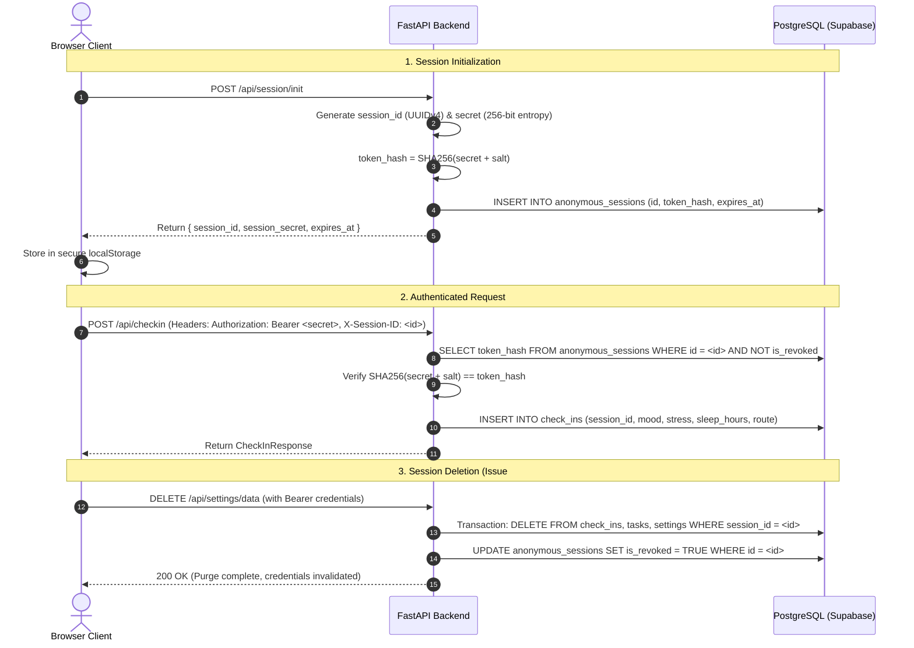

# Architecture & Database Review: Issue #10 & Issue #11

> **Status**: Proposed for Team Alignment & Review  
> **Primary Owner**: @roushan-23 (Member 4 — Database & Persistence)  
> **Collaborators**: Member 1 (Frontend/Session UX), Member 2 (Safety Engine), Member 3 (AI/LLM)  
> **Dependencies**: Issue #10 (Persistent Anonymous Sessions), Issue #11 (Privacy, Retention & Deletion)

---

## 1. Executive Summary & Core Requirements

Calmspace enables university students to check in and receive gentle, non-clinical wellbeing support completely anonymously, without registration, real names, or email addresses.

To transition from our current in-memory storage to persistent hosting while preserving absolute student privacy, we propose:
1. **Confirmed Database Provider**: PostgreSQL via Supabase (hosted) with Row-Level Security (RLS), accompanied by a local engine-agnostic repository layer for offline CI and testing.
2. **Cryptographic Anonymous Sessions**: Discarding predictable session IDs as unauthenticated authorization. Implementing high-entropy dual-token credentials (`session_id` + hashed `session_secret`).
3. **Strict Cross-Session Isolation**: Zero trust in client claims. Server-side ownership validation and RLS ensuring Session A can never read, modify, or delete Session B's data.
4. **Guaranteed Text Privacy**: Reflection text is **never persisted in database tables**.
5. **Issue #11 Retention & Deletion Contract**: Configurable retention (default 30 days), scheduled automated purges, and atomic, irreversible session deletion.

---

## 2. Anonymous Identity & Session Lifecycle

### Current vs. Proposed Architecture

| Property | Current MVP | Proposed Architecture (Issue #10) |
|---|---|---|
| **Identifier** | Client UUID in `localStorage` | UUIDv4 `session_id` |
| **Credential** | Plain `X-Session-ID` header | High-entropy 256-bit secret token (`Bearer <session_secret>`) |
| **Server Storage** | In-memory Python dictionary | Salted SHA-256 hash in PostgreSQL `anonymous_sessions` |
| **Tamper Resistance** | None (guessing an ID accesses data) | Cryptographically secure: guessing a `session_id` grants zero access |
| **Transport** | Header | `Authorization: Bearer <secret>` + `X-Session-ID: <uuid>` (never in URL params) |



---

## 3. Relational Schema Design (PostgreSQL / Supabase)

```sql
-- 1. Anonymous Sessions Table
CREATE TABLE IF NOT EXISTS anonymous_sessions (
    id UUID PRIMARY KEY DEFAULT gen_random_uuid(),
    token_hash VARCHAR(64) NOT NULL,
    created_at TIMESTAMPTZ NOT NULL DEFAULT timezone('utc', now()),
    last_active_at TIMESTAMPTZ NOT NULL DEFAULT timezone('utc', now()),
    expires_at TIMESTAMPTZ NOT NULL DEFAULT timezone('utc', now() + INTERVAL '90 days'),
    is_revoked BOOLEAN NOT NULL DEFAULT FALSE
);

CREATE INDEX IF NOT EXISTS idx_anonymous_sessions_lookup 
ON anonymous_sessions (id, is_revoked, expires_at);

-- 2. Check-Ins Table (Zero Reflection Text Stored!)
CREATE TABLE IF NOT EXISTS check_ins (
    id UUID PRIMARY KEY DEFAULT gen_random_uuid(),
    session_id UUID NOT NULL REFERENCES anonymous_sessions(id) ON DELETE CASCADE,
    timestamp TIMESTAMPTZ NOT NULL DEFAULT timezone('utc', now()),
    mood SMALLINT NOT NULL CHECK (mood BETWEEN 1 AND 5),
    stress SMALLINT NOT NULL CHECK (stress BETWEEN 1 AND 5),
    sleep_hours NUMERIC(4, 1) NOT NULL CHECK (sleep_hours >= 0.0 AND sleep_hours <= 24.0),
    route VARCHAR(10) NOT NULL CHECK (route IN ('LOW', 'MEDIUM', 'HIGH'))
);

CREATE INDEX IF NOT EXISTS idx_check_ins_session_time 
ON check_ins (session_id, timestamp DESC);

-- 3. Study Planner Tasks Table
CREATE TABLE IF NOT EXISTS study_tasks (
    id UUID PRIMARY KEY DEFAULT gen_random_uuid(),
    session_id UUID NOT NULL REFERENCES anonymous_sessions(id) ON DELETE CASCADE,
    title VARCHAR(120) NOT NULL,
    estimated_minutes SMALLINT NOT NULL CHECK (estimated_minutes BETWEEN 5 AND 240),
    category VARCHAR(50) NOT NULL DEFAULT 'Study',
    completed BOOLEAN NOT NULL DEFAULT FALSE,
    created_at TIMESTAMPTZ NOT NULL DEFAULT timezone('utc', now())
);

CREATE INDEX IF NOT EXISTS idx_study_tasks_session 
ON study_tasks (session_id, created_at DESC);

-- 4. User Settings Table
CREATE TABLE IF NOT EXISTS user_settings (
    session_id UUID PRIMARY KEY REFERENCES anonymous_sessions(id) ON DELETE CASCADE,
    nickname VARCHAR(60) NOT NULL DEFAULT 'Student',
    break_reminders_enabled BOOLEAN NOT NULL DEFAULT TRUE,
    reminder_interval_minutes SMALLINT NOT NULL DEFAULT 45,
    share_anonymous_analytics BOOLEAN NOT NULL DEFAULT FALSE,
    data_retention_days SMALLINT NOT NULL DEFAULT 30 CHECK (data_retention_days BETWEEN 7 AND 90),
    updated_at TIMESTAMPTZ NOT NULL DEFAULT timezone('utc', now())
);
```

---

## 4. Row-Level Security (RLS) & Isolation Policies

If Supabase is used directly by client or server queries, RLS policies enforce that each session can only access its own rows:

```sql
ALTER TABLE anonymous_sessions ENABLE ROW LEVEL SECURITY;
ALTER TABLE check_ins ENABLE ROW LEVEL SECURITY;
ALTER TABLE study_tasks ENABLE ROW LEVEL SECURITY;
ALTER TABLE user_settings ENABLE ROW LEVEL SECURITY;

-- Check-ins policy: Only authenticated session owner can read/insert
CREATE POLICY session_check_ins_policy ON check_ins
    FOR ALL
    USING (session_id = NULLIF(current_setting('app.current_session_id', true), '')::UUID)
    WITH CHECK (session_id = NULLIF(current_setting('app.current_session_id', true), '')::UUID);

CREATE POLICY session_study_tasks_policy ON study_tasks
    FOR ALL
    USING (session_id = NULLIF(current_setting('app.current_session_id', true), '')::UUID)
    WITH CHECK (session_id = NULLIF(current_setting('app.current_session_id', true), '')::UUID);

CREATE POLICY session_user_settings_policy ON user_settings
    FOR ALL
    USING (session_id = NULLIF(current_setting('app.current_session_id', true), '')::UUID)
    WITH CHECK (session_id = NULLIF(current_setting('app.current_session_id', true), '')::UUID);
```

---

## 5. Retention Schedule & Data Deletion (Issue #11 Dependency)

1. **Automated Rolling Retention Cleanup**:
   - Check-in records older than the student's configured `data_retention_days` (default 30 days) are pruned by a daily automated cleanup query:
     ```sql
     DELETE FROM check_ins c
     USING user_settings s
     WHERE c.session_id = s.session_id
       AND c.timestamp < NOW() - (s.data_retention_days || ' days')::INTERVAL;
     ```
2. **High-Route Escalation Records**:
   - Only numeric metrics (`mood`, `stress`, `sleep_hours`, `route="HIGH"`) are retained, adhering strictly to the same 30-day window for trend calculation.
   - No reflection text is ever stored.
3. **Irreversible Data Purge ("Delete All My Data")**:
   - Triggered via `DELETE /api/settings/data`.
   - Executes inside an atomic transaction:
     ```sql
     BEGIN;
     DELETE FROM check_ins WHERE session_id = :session_id;
     DELETE FROM study_tasks WHERE session_id = :session_id;
     DELETE FROM user_settings WHERE session_id = :session_id;
     UPDATE anonymous_sessions SET is_revoked = TRUE WHERE id = :session_id;
     COMMIT;
     ```
   - Client wipes `calmspace_anonymous_session_id` and recovery tokens from `localStorage` upon success.
   - The revoked session token cannot be reused to recreate or inspect prior history.

---

## 6. Required Verification & Cross-Session Isolation Tests

To consider Issue #10 and Issue #11 complete, automated integration tests must prove:
- [ ] **Cross-Session Read Protection**: Session A cannot read Session B's check-ins, tasks, or settings.
- [ ] **Cross-Session Mutation Protection**: Session A cannot update tasks or settings belonging to Session B.
- [ ] **Cross-Session Deletion Protection**: Session A cannot delete Session B's data.
- [ ] **Credential Forgery Protection**: Calling endpoints with Session B's `session_id` but an invalid secret returns `401 Unauthorized`.
- [ ] **Post-Purge Invalidation**: A revoked/deleted session token returns `401 Unauthorized` on subsequent calls.
- [ ] **Zero Reflection in DB**: Queries across database tables verify that zero free-text reflections are present.
- [ ] **Restart Persistence**: Data survives server restart without corruption or cross-talk.
