# Calmspace — End-to-End Hackathon Demo Journey & Presentation Guide

> **Issue #16 Deliverable**  
> **Target Audience**: Hackathon Judges, University Evaluators, and Technical Reviewers  
> **Duration**: 3 to 5 minutes  
> **Core Principle**: *"Rules decide safety. AI writes the language. Humans help."*

---

## 1. Presenter Roster & Role Assignments

| Speaker | Team Member | Presentation Focus |
|---|---|---|
| **Speaker 1 (Lead & Coordinator)** | **Roushan (@roushan-23)** | System architecture, privacy-first anonymous session model, persistent storage isolation, and live data deletion proof. |
| **Speaker 2 (Frontend & Design)** | Member 1 | Soft Editorial Wellness design philosophy, interactive 3D lavender mascot, single-column check-in UX, and Recharts analytics. |
| **Speaker 3 (Safety & Ethics)** | Member 2 | Pure deterministic safety engine (zero I/O), multilingual crisis corpus (English, Hindi, Hinglish), and the strict AI bypass guarantee. |
| **Speaker 4 (AI & Human Care)** | Member 3 | Supportive non-diagnostic language guardrails, graceful non-AI fallback, and the verified human support directory (`14416`, `112`). |

---

## 2. Timed 8-Step Presentation Walkthrough

```mermaid
flowchart LR
    S1["1. 3D Mascot Homepage\n(/)"] --> S2["2. Steady Check-In\n(Mood 4, Stress 2, Sleep 7.5h)"]
    S2 --> S3["3. Low-Route Result\n(Soft Sage + AI Pacing)"]
    S3 --> S4["4. Personal Insights & Planner\n(Recharts + 5-min Breather)"]
    S4 --> S5["5. Crisis Safety Proof\n(High Route + AI BYPASSED)"]
    S5 --> S6["6. Verified Helplines\n(Tele-MANAS 14416 + Campus)"]
    S6 --> S7["7. Privacy & 2-Step Wipe\n(Permanent Data Purge)"]
    S7 --> S8["8. Technical QA & Proof\n(38 Automated Tests Passing)"]
```



---

### Step 1: The Landing Experience & 3D Mascot (0:00 – 0:40)
- **URL**: `http://localhost:3000/`
- **Action**: Hover cursor or drag across the screen. Observe the volumetric 3D lavender blob gently leaning and smiling with subtle squash-and-stretch physics.
- **Presenter Script (Member 1)**:
  > *"Most student apps feel like cold clinical portals or stressful habit trackers with aggressive red badges and streak counters. Calmspace rejects that entirely. We designed a Soft Editorial Wellness sanctuary. Our 3D mascot offers an immediate, friendly breath of calm before any question is asked."*
- **Click**: Tap **"Enter Calmspace"** to navigate to `/app`.

---

### Step 2: Everyday Check-In — Low/Medium Route (0:40 – 1:20)
- **URL**: `http://localhost:3000/checkin`
- **Action**:
  1. **Mood**: Select `4 — Good`
  2. **Stress**: Select `2 — Low`
  3. **Sleep**: Adjust stepper to `7.5 hours`
  4. **Reflection**: Type: *"Finishing up my engineering assignment, feeling pretty good."*
  5. Toggle: *"Consent to supportive reflection assistance"* (ON)
  6. Click **"Complete Check-in"**
- **Presenter Script (Member 3)**:
  > *"Checking in takes less than 30 seconds. Notice that reflection text is strictly optional. If the student consents, our server-side adapter generates gentle, non-diagnostic encouragement. The prompt explicitly prevents clinical diagnoses or medical advice."*

---

### Step 3: Deterministic Result & Pacing Guidance (1:20 – 1:50)
- **Screen**: Check-In Result Screen (`/checkin/result`)
- **Visuals**: Soft Sage badge (`#DCE9DF`), Leaf icon, status: *"Doing okay"*.
- **Guidance Card**: Empathetic message with 2 suggestion chips (e.g. *"Take a stretch break"*, *"Hydrate"*).
- **Presenter Script (Member 2)**:
  > *"Notice the badge: 'Doing okay'. This route was not calculated by an LLM prompt. It was evaluated by our backend safety engine using deterministic mathematical thresholds. The AI only provides supportive words—it has zero authority over risk."*

---

### Step 4: Personal Insights & Study Pacing (1:50 – 2:30)
- **Navigation**: Click **"Insights"** in sidebar (`/insights`).
- **Visuals**: Three clean Recharts visualizations showing Mood, Sleep, and Stress trends over the last 7 days.
- **Accessible Summary**: *"Over your last check-ins, your mood averaged 4.0/5 with 7.5 hours average sleep..."*
- **Navigation**: Click **"Planner"** (`/planner`). Show the study task checklist and click **"Start 5-min Breather"** timer.
- **Presenter Script (Member 1)**:
  > *"The Insights tab transforms raw check-ins into visual self-awareness. Every chart includes an accessible plain-language summary for screen readers. No comparative shaming, no clinical jargon—just clear, actionable personal trends."*

---

### Step 5: The High-Risk Escalation Proof — AI Bypassed! (2:30 – 3:30)
> **CRITICAL JUDGING MOMENT**: Demonstrates safety integrity.

- **Action**: Click **"Check-in"** again. Enter synthetic crisis data:
  1. **Mood**: `1 — Very low`
  2. **Stress**: `5 — Very high`
  3. **Sleep**: `2.5 hours`
  4. **Reflection**: *"I can't take this anymore, everything is falling apart."*
  5. Click **"Complete Check-in"**.
- **Result**:
  - The UI instantly switches to a **High-Contrast, Distraction-Free Calm Plum/Ink interface**.
  - Headline: *"You don't have to carry this alone."*
  - **AI IS 100% BYPASSED**: No chat bubbles, no synthetic hallucinations, no generic bot responses.
- **Presenter Script (Member 2 & Roushan)**:
  > *"This is the core ethical breakthrough of Calmspace. When acute distress or crisis keywords are detected—even in Hinglish or Hindi—the application immediately and unconditionally bypasses AI. We never let an LLM improvise when a human life may be in danger. Instead, the student gets instant, one-tap access to certified human professionals."*

---

### Step 6: Verified Human Support Directory (3:30 – 4:00)
- **Visuals**: High-priority cards:
  1. **Tele-MANAS**: National 24/7 Helpline (`14416` / `1800-891-4416`) — Verified: Govt. of India MoHFW.
  2. **Campus Student Wellbeing Unit**: Dean of Student Affairs Directory (`+91 (011) 2659-7100`).
  3. **National Emergency**: Immediate Dispatch (`112`).
- **Presenter Script (Member 3)**:
  > *"Every resource includes its verified source and last-audit date. Students can tap to call directly without searching or leaving the application."*

---

### Step 7: Privacy by Design & Permanent Data Wipe (4:00 – 4:30)
- **Navigation**: Click **"Settings"** (`/settings`).
- **Visuals**: Display anonymous Session ID (e.g. `student-a8f19c2d`). Show that no name, email, or college roll number is attached.
- **Action**:
  1. Click **"Delete all my data"**.
  2. Confirm in the 2-step verification modal.
  3. Return to **Insights** (`/insights`) — verify that all charts and historical check-ins are immediately and permanently erased.
- **Presenter Script (Roushan)**:
  > *"Privacy in Calmspace is architectural, not contractual. Notice our database schema: reflections are never saved—even on the server. Data is indexed solely by an anonymous token. And when a student asks to delete their data, our backend executes a complete, transactional purge across all tables. Their data is truly gone."*

---

### Step 8: Technical Wrap-Up & Automated Test Evidence (4:30 – 5:00)
- **Presenter Script (Roushan)**:
  > *"Calmspace is backed by 38 automated tests covering 100% of safety routing, session isolation, cross-session security, multilingual crisis detection, and data persistence across server restarts. We have built an emotionally comforting, ethically guarded platform ready for university campuses."*

---

## 3. Deterministic Synthetic Demo Dataset

| Persona | Mood | Stress | Sleep (hrs) | Synthetic Reflection | Expected Route | Expected AI Behavior |
|---|:---:|:---:|:---:|---|:---:|---|
| **Steady Baseline** | 4 | 2 | 7.5 | *"Finished my assignment, going for a walk."* | **LOW** | Supportive pacing advice + 2 chips |
| **Exam Fatigue** | 2 | 4 | 5.0 | *"Struggling to keep up with lab reports."* | **MEDIUM** | Grounding breath exercise + campus link |
| **Acute Crisis** | 1 | 5 | 2.5 | *"I can't take this anymore, I feel so helpless."* | **HIGH** | **AI BYPASSED**; Instant Tele-MANAS escalation |

---

## 4. Pre-Demo Checklist (15 Minutes Before Pitch)

- [ ] **Python Backend Running**:
  ```powershell
  & ".\.venv\Scripts\python.exe" -m uvicorn app.main:app --port 8000 --reload
  ```
- [ ] **Frontend Dev Server Running**:
  ```powershell
  npm --prefix frontend run dev
  ```
- [ ] **Health Endpoint Verified**: `http://localhost:8000/api/health` returns `200 OK`.
- [ ] **Clean Browser Session**: Open Chrome in an Incognito window at `http://localhost:3000` to ensure no stale `localStorage` session token exists.
- [ ] **Backup Offline Fallback**: The React frontend includes built-in offline demo resilience (`FALLBACK_SUPPORT_RESOURCES` in `api.ts`), ensuring the presentation never crashes even if the network fluctuates.
