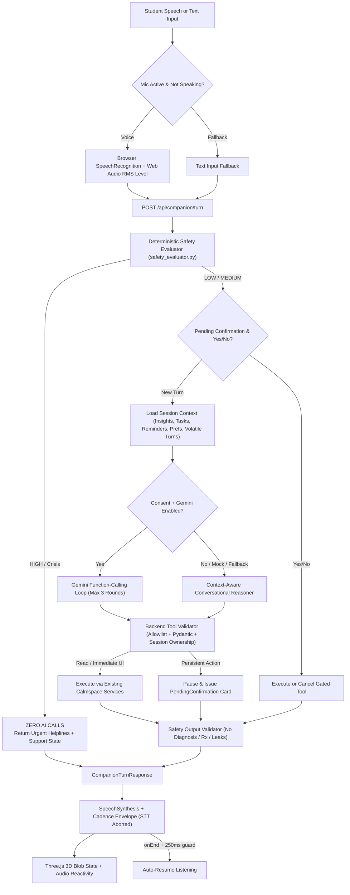
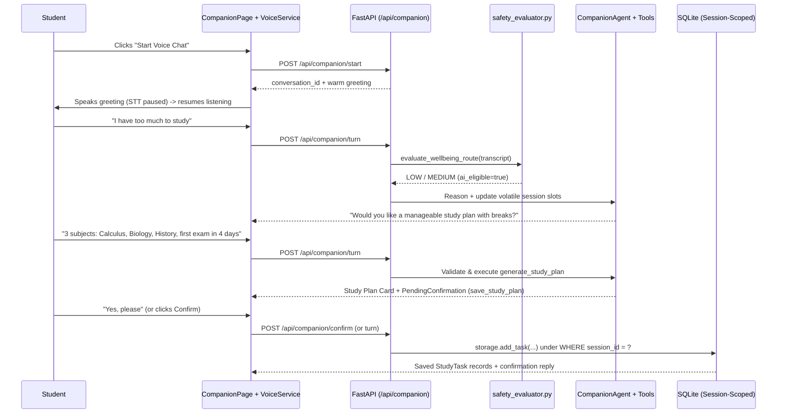

# Calm — Agentic AI Voice Wellbeing Companion Architecture

> **Guiding Principle**: *Rules decide safety. AI writes the language. Humans help. Privacy by default.*

## 1. End-to-End Voice & Safety Pipeline

## 2. Multi-Turn Conversation & Confirmation Flow

## 3. Environment Configuration

Backend (`backend/app/.env`, copied from `backend/.env.example`):

- `CALMSPACE_AI_PROVIDER`: `"mock"` (offline context-aware default) or `"gemini"` (live Gemini function calling).
- `CALMSPACE_AI_MODEL`: `"gemini-1.5-flash"` (or `"gemini-2.0-flash"` / `"gemini-2.5-flash"`).
- `CALMSPACE_AI_API_KEY` / `GEMINI_API_KEY`: Sent strictly via `x-goog-api-key` HTTP header.
- `CALMSPACE_AI_ENABLED`: `"true"` or `"false"`.
- `CALMSPACE_AI_TIMEOUT_SECONDS`: `"5.0"` (companion loop enforces at least 8.0s when calling Gemini).
- `CALMSPACE_AI_RATE_LIMIT_PER_MINUTE` / `CALMSPACE_AI_DAILY_BUDGET_LIMIT`: Per-session and daily caps.

Frontend (`frontend/.env`, copied from `frontend/.env.example`):

- `VITE_API_BASE_URL=/api` (proxied to `http://127.0.0.1:8000` in Vite dev).

## 4. Privacy & Session Guarantees

- **No Raw Audio Storage**: Web Audio API `AnalyserNode` computes amplitude in transient RAM only; no `MediaRecorder` or audio files are created.
- **Volatile Transcripts**: Conversation history lives exclusively in `companion_memory` (RAM) and is cleared immediately on `DELETE /api/companion/session/{conversation_id}` or `DELETE /api/settings/data`.
- **Confirmation Gates**: `create_reminder`, `commit_checkin`, `save_study_plan`, and `save_companion_preference` require explicit user confirmation before writing to SQLite.
- **Immutable Safety Engine**: `backend/app/services/safety_evaluator.py` is unmodified and runs prior to any AI reasoning.
